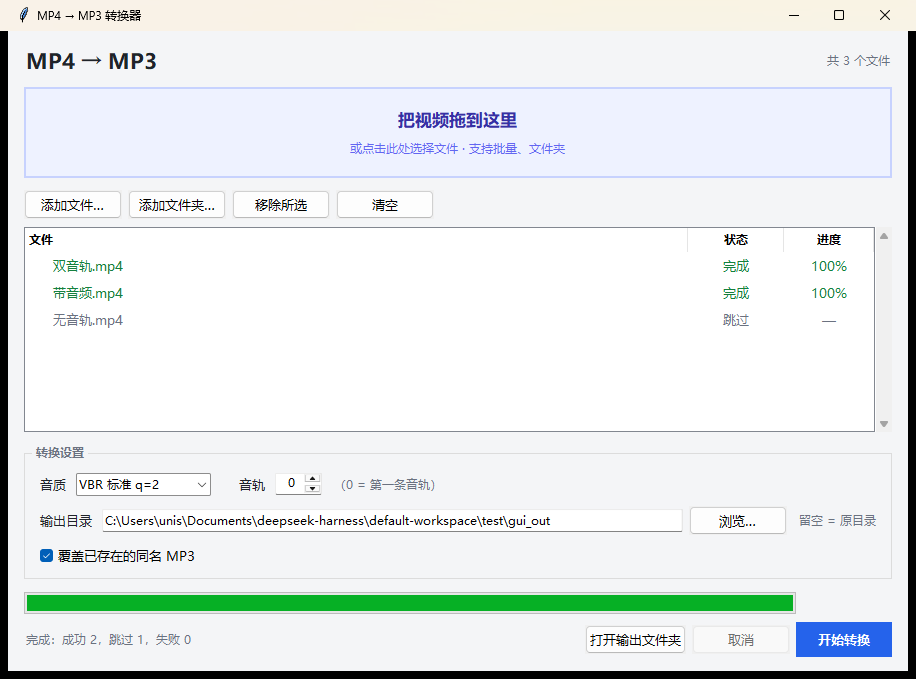

# MP3Shift

把 MP4 / MOV / MKV 等视频一键转成 MP3 的 Windows 桌面小工具。界面用 tkinter，转码内核是 ffmpeg。



## 功能

- 拖放或选择视频 / 文件夹，批量队列
- 逐文件进度 + 总进度，后台线程转换，界面不卡
- 音质：VBR q=2（默认，约 190kbps）/ VBR q=0 / 128 / 192 / 320 kbps
- 多音轨视频可选第几条音轨
- 输出目录可选，默认放在原视频旁边
- 同名 MP3 默认不覆盖，可勾选覆盖
- 无音轨视频自动跳过；中文、超长文件名正常
- 转码时不会弹出黑色命令行窗口
- 支持把视频拖到 `MP3Shift.exe` 图标上直接加入队列

## 直接使用（不装 Python）

到 [Releases](../../releases) 下载 `MP3Shift-win64.zip`，解压后双击 `MP3Shift.exe`。

> exe 没有数字签名，首次运行 Windows SmartScreen 可能提示「已保护你的电脑」，点「更多信息 → 仍要运行」。
> 个别杀毒软件会对 PyInstaller 打包的程序误报，把整个文件夹加入信任即可。

## 从源码运行

需要 Python 3.10+（用到了 `X | None` 类型标注）。

```powershell
pip install -r requirements.txt
# 先按下面「准备 ffmpeg」放好 ffmpeg
python mp4_to_mp3_gui.py
```

也可以把视频拖到 `转换.bat` 上走命令行转换，或双击 `桌面版.bat` 启动界面。

### 准备 ffmpeg

任选一种：

- `winget install Gyan.FFmpeg`
- 下载 <https://www.gyan.dev/ffmpeg/builds/> 的 essentials 包，把 `ffmpeg.exe` 放到 `ffmpeg\bin\`
- 只要 ffmpeg 在 PATH 里，程序也能找到

程序查找 ffmpeg 的顺序：环境变量 `FFMPEG_DIR` → 程序所在目录 / `ffmpeg\bin` → PATH → winget 安装目录 → `C:\ffmpeg`。

## 打包成 exe

```powershell
.\build.ps1
```

输出在 `dist\MP3Shift\`（onedir 形式，启动比单文件 exe 快）。脚本会自动把 `ffmpeg\bin` 复制进去，然后整个文件夹即可分发。

## 命令行用法

```powershell
python mp4_to_mp3.py 视频.mp4
python mp4_to_mp3.py a.mp4 b.mp4 -o D:\音乐 --bitrate 320k
python mp4_to_mp3.py 视频文件夹 --force
```

参数：

| 参数 | 说明 |
|:--|:--|
| `-o, --out-dir` | 输出目录（默认原视频所在目录） |
| `-b, --bitrate` | 固定码率，如 `128k` / `192k` / `320k` |
| `-q, --quality` | VBR 质量 0–9，越小越好，默认 2 |
| `-t, --track` | 第几条音轨，从 0 开始 |
| `-f, --force` | 覆盖同名 MP3 |
| `--ffmpeg` | 手动指定 ffmpeg 可执行文件 |

## 目录结构

```
mp4_to_mp3.py       # 核心：ffmpeg 调用、媒体探测、进度回调、CLI
mp4_to_mp3_gui.py   # tkinter 界面
转换.bat            # 拖放到 bat 上做命令行转换
桌面版.bat          # 双击启动界面
build.ps1           # PyInstaller 打包脚本
```

## 已知限制

- 「取消」会在当前文件转完后生效，避免留下写了一半的 MP3
- 只取视频里的音轨，不保留封面图和字幕
- Windows 专用（CREATE_NO_WINDOW、DPI 适配、中文路径等处理）

## License

MIT
